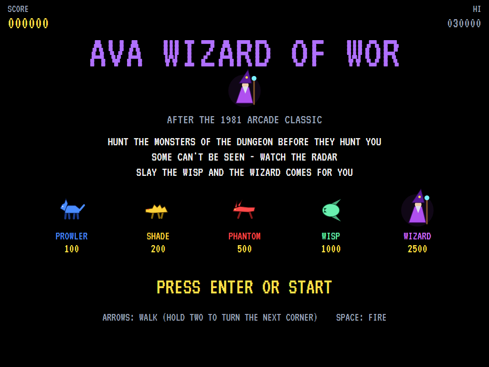
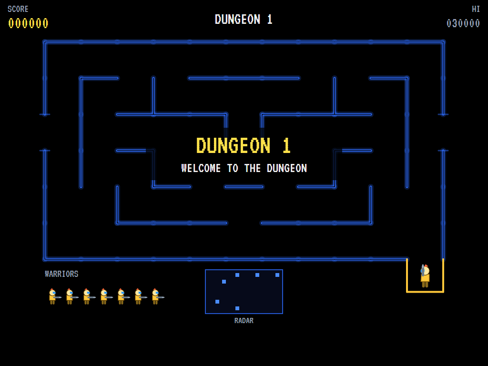
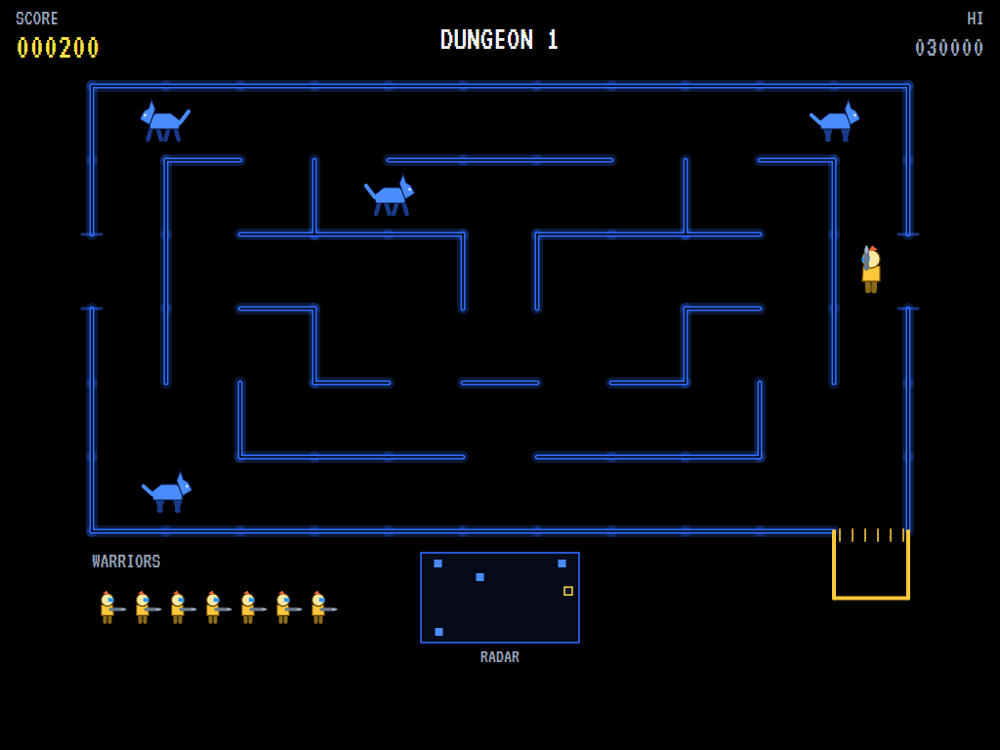
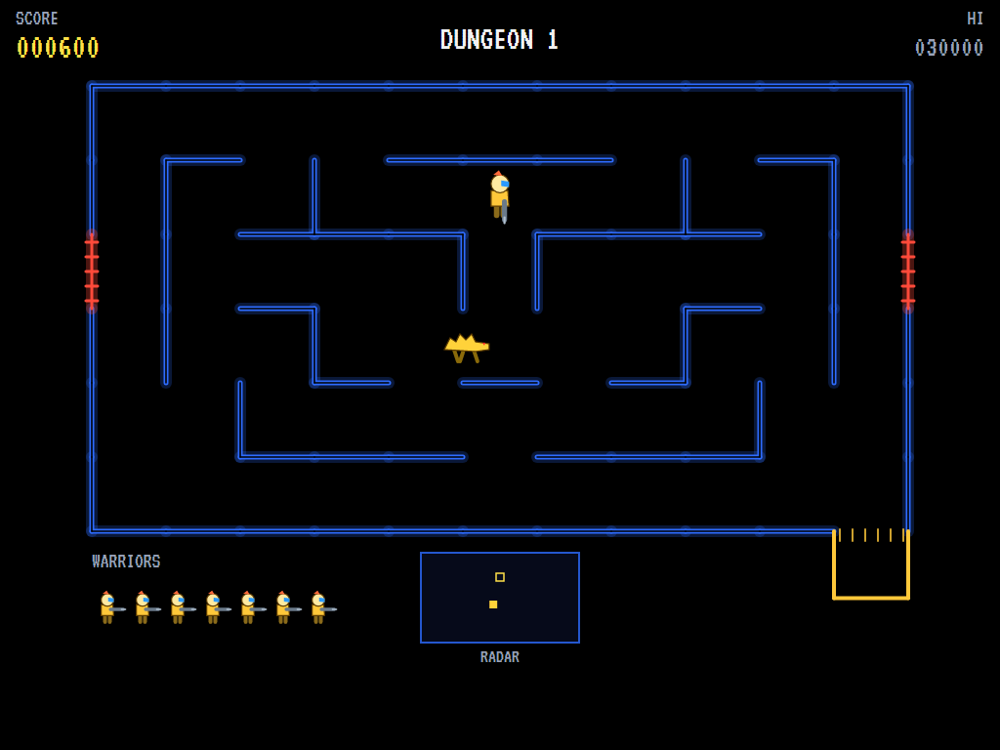
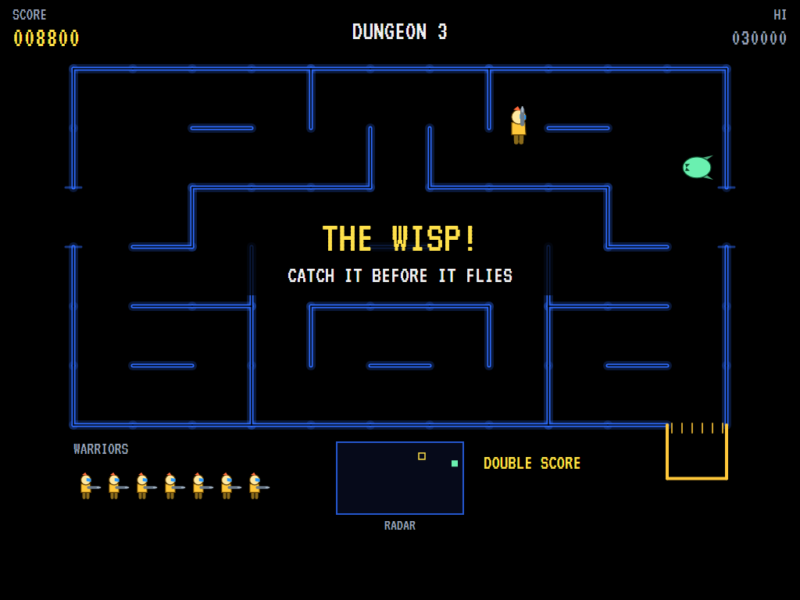
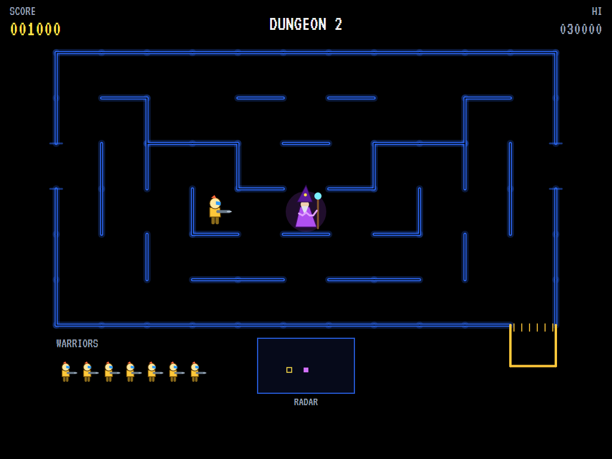
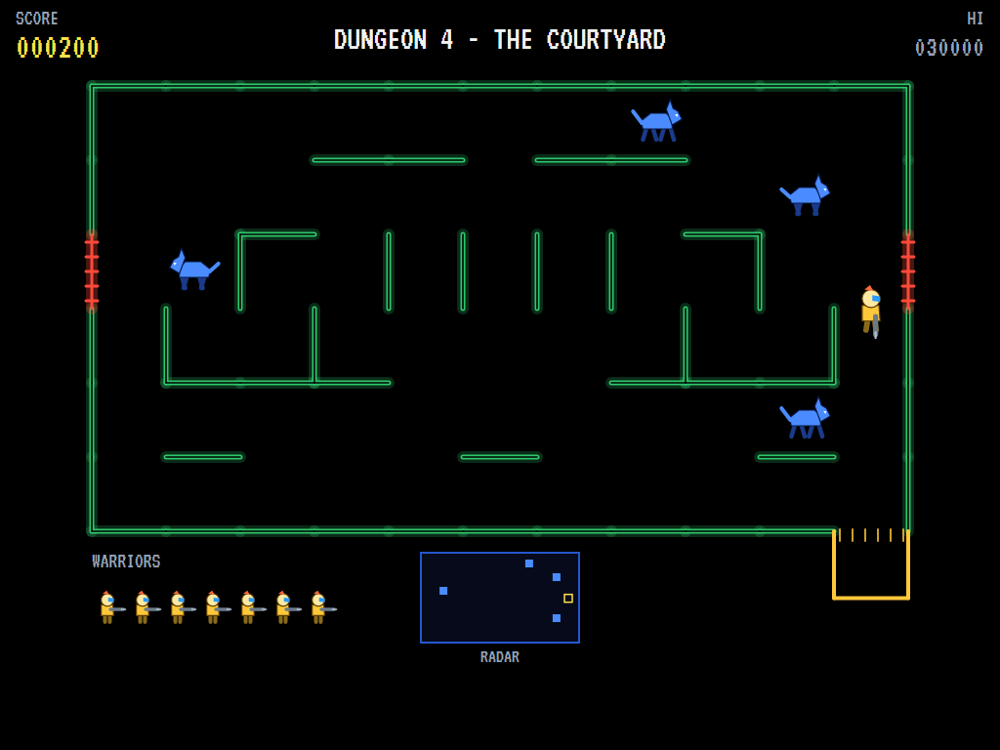
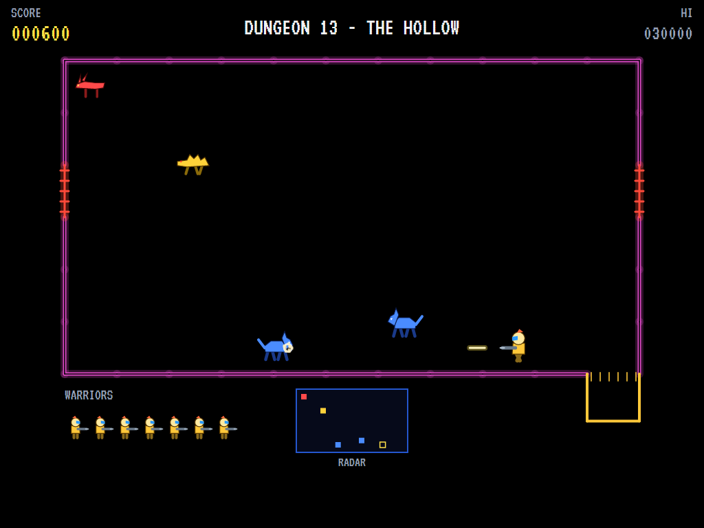
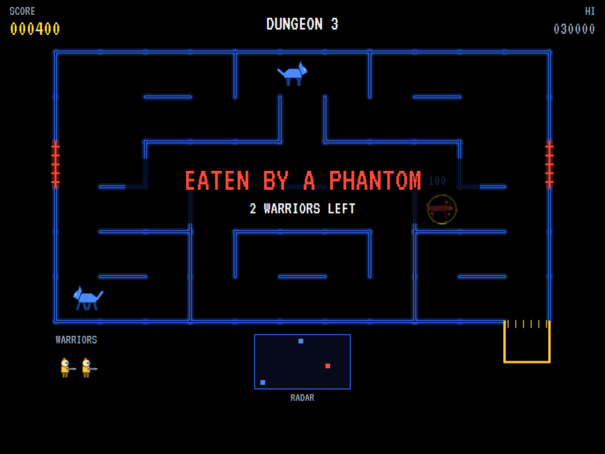
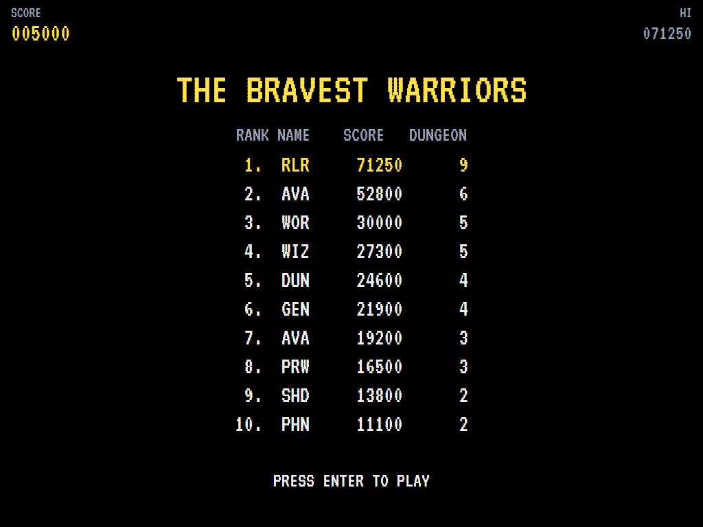

# AVA Wizard of Wor

[](https://github.com/Harlock123/AVAWizardOfWor/actions/workflows/build.yml)

A dungeon shoot-out in the style of Midway's 1981 arcade game **Wizard of Wor**, built with .NET 10 and
Avalonia UI. A warrior with a blaster stalks the corridors of a dungeon after the monsters that stalk it.
Some of them can't be seen, so watch the radar. Clear a dungeon and the wisp comes. Slay the wisp and the
wizard comes for you.

## Features

- **The dungeons**:
  - **The layout:** eleven cells by six, the same on the left as on the right, with no dead ends.
  - **The doors:** a door out of each side leads round to the other, and both shut for a while behind whoever goes through.
  - **Building them:** each dungeon is built from its number, so it is the same every time.
  - **Special dungeons:** every fourth is **the Courtyard**, wide open. The thirteenth and every sixth after it is **the Hollow**, with no walls inside at all.
- **The warrior**:
  - **The cage:** it waits safe in its cage below the dungeon until you move, or until the count runs out.
  - **Moving:** it walks while the stick is held and stands when you let go. It turns to face a wall it can't walk into, so you can aim without moving. Hold two ways at once to turn the next corner.
  - **Firing:** one shot at a time flies down the corridor until a wall stops it. Shots that meet head on knock each other out.
- **The monsters**:
  - **Prowlers** are blue beasts, always in plain sight.
  - **Shades** are yellow. The last few prowlers each leave one behind.
  - **Phantoms** are red and fast. Each shade you slay leaves one.
  - **Shades and phantoms can't be seen** unless they're close by or straight down a corridor from the warrior. The radar always shows them.
  - **Hunting and shooting:** they hunt the warrior through the maze, and shoot when they face it down a clear corridor.
  - **The heartbeat:** the longer a dungeon lasts and the fewer monsters are left, the faster they move, and the faster the dungeon's heart beats.
- **The wisp**: from the second dungeon, once the rest are gone, the wisp appears and makes for a side door. Slay it before it flies and the next dungeon is a **double score dungeon**.
- **The wizard**: slay the wisp and the wizard comes for you. It vanishes and reappears close by, and throws lightning the moment it sees you. Slay it, or survive until it vanishes.
- **Scoring**:
  - Prowlers 100, shades 200, phantoms 500, the wisp 1,000, the wizard 2,500
  - Everything is doubled in a double score dungeon
  - An extra warrior at 12,000 and every 30,000 after that
- **Sound**: the dungeon's heartbeat over a low drone, with blasters, clashing shots, monsters appearing and falling, the doors, the wisp's whine, the wizard's arrival, his lightning and his hops, plus new tunes for the title and start. All of it is synthesised and mixed by OpenAL.
- **Attract mode**: leave the title alone for 15 seconds and a computer warrior plays. It watches the radar, shoots whatever comes straight down a corridor at it (bullets included), backs away from anything close round a corner, walks to a spot with a clear shot, and waits in the cage while something lurks by the way out.
- **A top-ten high-score table** with arcade-style initials entry. It records the dungeon reached.
- **Gamepads** through SDL2, as well as the keyboard.
- **Any window size**: the screen scales to fit, letterboxed. **Ctrl+S** saves a screenshot.
- **One self-contained executable** per platform: Windows, macOS and Linux on Intel/AMD and ARM.

## Screenshots

| The title | Dungeon 1 | The hunt |
|:---------:|:---------:|:--------:|
|  |  |  |
| What everything is worth. | Welcome to the dungeon. | Prowlers in plain sight. |

| A shade | The wisp | The wizard |
|:-------:|:--------:|:----------:|
|  |  |  |
| Seen only close up, or down the corridor. | Catch it before it flies. | He has come for you. |

| The Courtyard | The Hollow | Eaten |
|:-------------:|:----------:|:-----:|
|  |  |  |
| Every fourth dungeon. | No walls at all. | The next warrior waits in the cage. |

| The bravest warriors | | |
|:--------------------:|:-:|:-:|
|  | | |
| The high-score table. | | |

The screenshots are made by the tests, which play the game in a real (headless) window; see
[Tests](#tests).

## Download and run

Ready-to-run builds for Windows, macOS and Linux, on both Intel/AMD and ARM, are on the
[Releases page](https://github.com/Harlock123/AVAWizardOfWor/releases/tag/latest). **Latest build** is
rebuilt on every push to `main`. Each download is one self-contained executable: no .NET install is
needed.

| Platform | Archive |
|---|---|
| Windows | `AVAWizardOfWor-win-x64.zip`, `AVAWizardOfWor-win-x86.zip`, `AVAWizardOfWor-win-arm64.zip` |
| macOS | `AVAWizardOfWor-osx-arm64.tar.gz` (Apple silicon), `AVAWizardOfWor-osx-x64.tar.gz` (Intel) |
| Linux | `AVAWizardOfWor-linux-x64.tar.gz`, `AVAWizardOfWor-linux-arm64.tar.gz`, `AVAWizardOfWor-linux-arm.tar.gz` |

```bash
tar -xzf AVAWizardOfWor-linux-x64.tar.gz     # or linux-arm64, linux-arm, osx-arm64, osx-x64
./AVAWizardOfWor
```

On Windows, unzip and run `AVAWizardOfWor.exe`. On macOS, if Gatekeeper refuses to open it, run
`xattr -d com.apple.quarantine AVAWizardOfWor` once. Run with `--no-audio` for silence.

**Sound** comes through OpenAL Soft, built in for every platform. In a virtual machine the game
detects it and uses a larger audio buffer, so the sound doesn't break up.

**Gamepads** use SDL2, which is bundled for Windows, macOS and Intel/AMD Linux. ARM Linux builds need it
installed; without it the keyboard still works:

```bash
sudo apt install libsdl2-dev            # Debian / Ubuntu / Raspberry Pi OS
sudo pacman -S --needed sdl2-compat     # Arch / Omarchy
```

## Controls

| Input | Action |
|-------|--------|
| **Enter** | Start |
| **Arrow keys** / **W A S D** (or the numeric keypad) | Walk; hold two at once to turn the next corner |
| **Space** / **Z** / **X** / **Ctrl** | Fire |
| **P** / **Esc** | Pause (Esc again to quit) |
| **M** | Mute |
| **Ctrl+S** / **Cmd+S** | Save a screenshot to the Pictures folder |

**Gamepad**: left stick or D-pad to walk, **A**, **B** or **X** to fire, **Start** to start and pause,
**Back** (while paused) to quit.

**Entering initials**: type letters, or dial with **Up**/**Down** and accept with **Space**; **Left** /
**Backspace** go back; **Enter** finishes.

## Tests

```bash
dotnet test AVAWizardOfWor.slnx
```

The engine has no UI and runs in fixed 60 Hz steps, so it plays the same at any frame rate, and a seed
always plays the same game. The tests check:

- **The dungeons:**
  - every one mirrored, joined up, with no dead ends, and the same every time
  - courtyards more open, and the hollow with no walls inside
- **The warrior:**
  - the cage, safe until it moves or the count runs out
  - walking while the stick is held, walls stopping it but not its turning to face them
  - turning the next corner with two ways held
  - the side doors leading round and shutting behind it
- **Shooting:** one shot at a time stopped by walls, a prowler slain for 100, and shots meeting head on
- **The monsters:**
  - shades from the last prowlers and phantoms from the shades
  - the unseen ones, seen only close or in line
  - chasing, and firing down a corridor when facing the warrior
  - bullets and monsters ending the warrior, the next from the cage, and the last ending the game
  - hurrying as time goes on
- **The wisp and the wizard:**
  - the first dungeon ending with its monsters
  - the wisp from the second, the wizard after it, and the double score dungeon
  - the wisp escaping through a door, and the wizard hopping about and in the end vanishing
- **The machine:** extra warriors, the computer warrior clearing the first dungeons, the attract cycle, the same game from the same seed, initials and the high-score file

The screenshot tests draw the real screen in a headless window. To refresh the README's pictures:

```bash
WOR_SHOTS=$PWD/Images dotnet test tests/AVAWizardOfWor.Tests --filter ScreenshotTests
```

To see how the computer warrior gets on, dungeon by dungeon (for tuning), or how a player who only stands
by the cage and fires does (`WOR_PROBE=lazy`):

```bash
WOR_PROBE=1 dotnet test tests/AVAWizardOfWor.Tests --filter PilotProbe --logger "console;verbosity=detailed"
```

## Building

```bash
dotnet build AVAWizardOfWor.slnx
dotnet run --project src/AVAWizardOfWor
```

Needs the .NET 10 SDK. The sounds are made by `tools/make_sounds.py` (standard-library Python):
`python3 tools/make_sounds.py` rewrites `src/AVAWizardOfWor/Sounds`.

## Project structure

```
AVAWizardOfWor/
├── AVAWizardOfWor.slnx
├── src/AVAWizardOfWor/
│   ├── Engine/
│   │   ├── GameEngine.cs        # States, the title and demo cycle, and the drone
│   │   ├── GameEngine.Play.cs   # The warrior and its cage, walking the corridors, the doors, shots,
│   │   │                        # the monsters, the wisp and the wizard, the heartbeat and scoring
│   │   ├── Maze.cs              # Building each dungeon; ways through, distances and lines of sight
│   │   ├── WarriorPilot.cs      # The computer warrior, for the demonstration (and the tests)
│   │   ├── Entities.cs
│   │   ├── HighScoreTable.cs, InitialsEntry.cs
│   │   ├── InputHandler.cs, ControllerManager.cs  # Keys and an SDL2 gamepad
│   │   └── SoundManager.cs      # Effects, the heartbeat and the tunes through OpenAL
│   ├── Audio/                   # The OpenAL engine (from the author's AVABand)
│   ├── Views/                   # The neon dungeon, the warrior and the monsters, the radar, the screens
│   └── Sounds/                  # The synthesised effects and tunes
├── tests/AVAWizardOfWor.Tests/  # Gameplay, screenshot and probe tests
├── tools/make_sounds.py
└── Images/                      # Screenshots
```

## About and licence

AVA Wizard of Wor © 2026 Lonnie Watson, under the [MIT License](LICENSE).

*Wizard of Wor* © 1981 Midway; the name belongs to its current owner. AVA Wizard of Wor is an independent,
unofficial game in its style. Its warrior, its monsters and their names, its dungeons, graphics, sounds,
tunes and code are its own; nothing is taken from the arcade machine's program, graphics, sound or music.
It is not affiliated with or endorsed by any rights holder.
